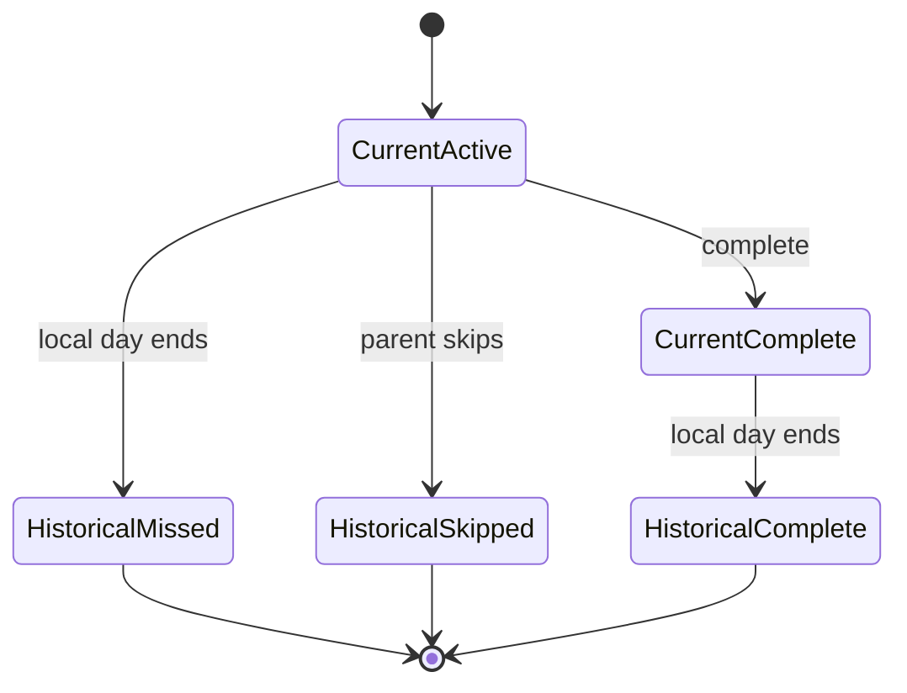

## Context

Daily recurrence is explicitly post-MVP. It extends stable Todo lifecycle/history behavior with immutable dated occurrences so a missed day remains useful history without intruding on today's work.

## Goals / Non-Goals

**Goals:** daily templates, household-local dated occurrences, idempotent rollover, and non-actionable historical rounds.

**Non-Goals:** weekly/monthly recurrence, arbitrary schedules, ordered routine checklists, push notifications, rewards, and retroactive child completion.

## Decisions

- A recurrence template owns immutable date-keyed Todo occurrences. Occurrence ID uniqueness derives from template ID and household-local date.
- Generate current-day occurrences via scheduled invocation with a lazy read-time reconciliation fallback. Both use conditional writes.
- Use Household timezone stored at bootstrap, never browser-local timezone, for date boundary calculations.
- Current occurrences reuse active Todo presentation; history is read-only for children.
- Parent skip transitions only current active occurrences and retains reason/state metadata.

## Risks / Trade-offs

- Scheduled execution may fail or run late; lazy reconciliation and health alerts mitigate missing current work.
- Daylight-saving transitions require date arithmetic in the household IANA timezone rather than fixed 24-hour intervals.

## Migration Plan

- Introduce templates and occurrence keys without changing one-off Todo records.
- Release daily creation and query behavior before enabling the schedule.
- Roll back schedule safely; existing occurrences remain normal historical records.
