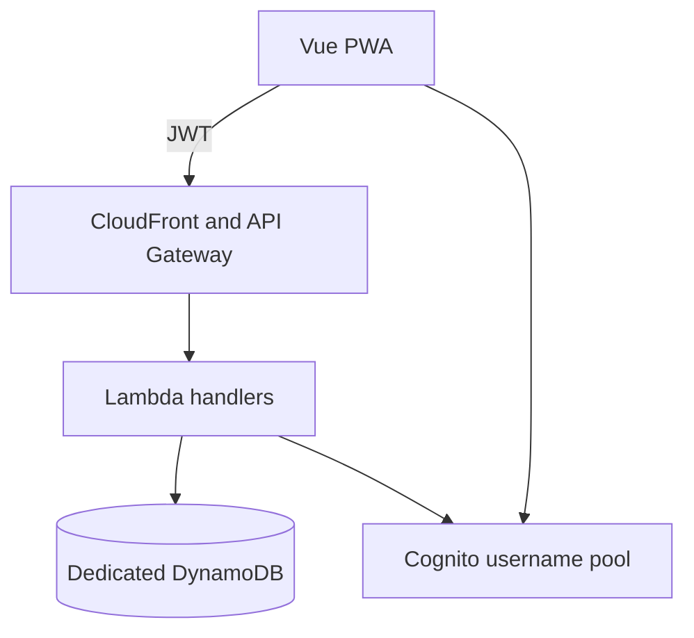

## Context

Todone is a greenfield private family PWA. The local `weather` application demonstrates Vue 3, Vite, TypeScript, Tailwind, PWA, Lambda, and local Express development. `family-paas` provides Terraform modules for S3/CloudFront hosting, API Gateway, Lambda, Cognito, and DynamoDB. Its current shared Cognito pool is unused and email-oriented, so it will be replaced rather than adapted around an incompatible identity model.

## Goals / Non-Goals

**Goals:**
- Establish a deployable, testable, accessible PWA and protected API boundary.
- Use globally unique immutable Cognito usernames, stable `sub` identities, and a dedicated recoverable table.
- Keep operational cost and moving parts low.
- Establish the durable architecture, UX, security, and testing sources of truth required by later changes.

**Non-Goals:**
- Household creation, account management, Todo persistence, or recurrence.
- Production automatic deployment on every commit.
- Offline mutation queues or native iOS packaging.
- A staging environment; this application deploys to one production environment.

## Decisions

### Runtime architecture

- Use Vue 3, Vite, TypeScript, Tailwind, and the existing PWA pattern.
- Use API Gateway HTTP API JWT authorization for protected routes.
- Replace the empty shared Cognito pool with a case-insensitive username-based pool. Usernames are globally unique and immutable; display names remain application profile data. Email and phone are optional pool attributes so later parent-account recovery can require verified email without requiring contact attributes for children.
- Use a dedicated on-demand DynamoDB table with `pk` and `sk`, point-in-time recovery, and a typed persistence boundary.
- Use manual reviewed Terraform deployments to one production environment and retain prior frontend and Lambda artifacts for rollback.
- Return exactly `sub`, `username`, and `expiresAt` from the current-session probe.

### Temporary authentication proof

- Include a minimal throwaway sign-in form and create a verification-only test account through an administrator setup command or script, not self-registration.
- The form proves username/password authentication, session storage, JWT forwarding, and the protected endpoint. `bootstrap-household-membership` replaces the form and removes its obsolete setup/tests.
- Use default Cognito password protection and throttling. Additional adaptive-security or lockout features are out of scope.

### Cross-repository handoff and durable documentation

- Produce a requirements handoff for a separate `family-paas` agent covering the username pool, app-client, authorizer, table, PITR, IAM, and output contracts Todone needs. The other repository owns its internal technical design.
- Before application implementation, create canonical documents for system context, data model/access patterns, API conventions, responsive accessibility, global user flows, shared interaction states, threat model, authorization matrix, testing strategy, and deployment/rollback/backup operations.
- Record ADRs for the PWA client, Cognito identity model, dedicated DynamoDB/PITR choice, server-side household authorization, manual production deployment, and household-local date semantics.

### Reliability and observability

- Runtime writes use request IDs and structured outcome logs. Logs exclude credentials, token values, names, and product content.
- Track API error count, API latency, and authorization denials. No product analytics is collected.
- Document a point-in-time recovery restore drill. A restore creates a separate table and requires deliberate data verification before cutover.

### Testing strategy

- Unit tests cover local behavior and validation.
- Integration tests cover authenticated API behavior using realistic JWT verification and table access.
- Playwright covers the temporary sign-in and protected-route access.
- Accessibility checks cover the shell and temporary sign-in surface at representative iPhone, iPad, and laptop sizes using compact below 768px, medium 768–1023px, and wide at or above 1024px.
- A human-authorized production deployment smoke test confirms live sign-in and protected API behavior; agents do not deploy without explicit authorization.

## Risks / Trade-offs

- Replacing shared Cognito is destructive. Verify it is empty immediately before Terraform apply and coordinate any new platform consumer first.
- DynamoDB requires deliberate query-driven modeling. The product’s bounded family access patterns make this a favorable trade-off over operating a relational database.
- A dedicated table adds no fixed per-table on-demand cost; requests, storage, and PITR are usage-based and negligible at family scale.
- The temporary sign-in form creates deliberate short-lived code. The bootstrap change must remove it rather than preserve a compatibility path.
