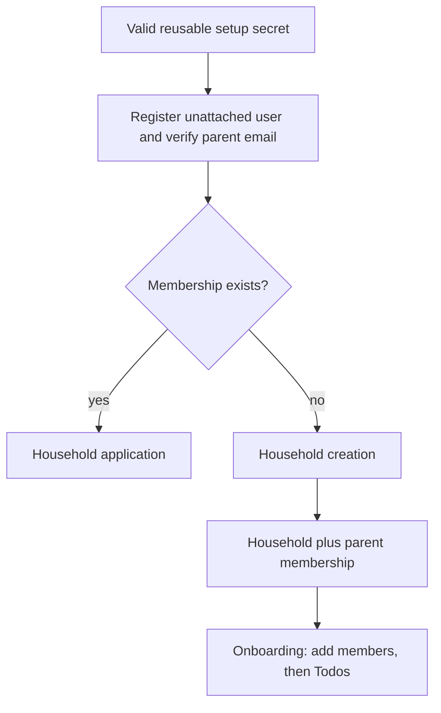

## Context

The foundation supplies username identity, a protected API, and an intentionally temporary sign-in probe, but no application tenant. This change removes that probe, delivers the production session and parent-recovery flow, and turns the only self-registered user into the first parent of the required household.

## Goals / Non-Goals

**Goals:** production session lifecycle, reusable setup-gated first-parent registration, parent recovery, one household per self-registered account, timezone confirmation, and server-enforced isolation.

**Non-Goals:** household invitations, joining existing households, family account administration, or Todos.

## Decisions

- Remove the temporary foundation sign-in and its verification-account setup after the production registration, sign-in, recovery, restoration, and sign-out paths pass their tests.
- Store the reusable deployment setup secret outside application data and validate it server-side. Public registration creates no Membership and never accepts an existing household as a join target. Each registered non-member may create one new household; later accounts in that household are parent-provisioned.
- Require and verify email for the first parent so Cognito Forgot Password has a trusted recovery channel. Email remains optional at the pool level for future child accounts.
- Persist Household, Membership, and user-to-household lookup items in the dedicated table. Membership includes immutable `role`, initially `parent`, so later account provisioning does not require a membership migration.
- Treat Cognito `sub` as the membership identity key.
- Create the household and initial parent membership transactionally or make retries idempotent with a request key. A condition on the user-to-household lookup rejects second households for the same account while allowing other setup-authorized accounts to create separate households.
- Resolve household membership in a shared authorization layer before every household route.
- Store an IANA timezone and use date-only transport values, not client timestamps, in later features.
- After creation, display the household name and an onboarding next step to add family members. Todo creation remains unavailable until its later change.
- Follow the foundation's canonical data-model, API, authorization, responsive-accessibility, interaction-state, and testing documents.

## Risks / Trade-offs

- The deployment setup secret is a reusable bootstrap control, not a household invitation system. Anyone who knows it can create a separate household, so rotation is an operator responsibility.
- A failed Cognito sign-up cannot be rolled back from the application; the membership gate prevents it from accessing product content.
- Cognito usernames are globally unique and immutable. Non-unique mutable display names are stored later in application profiles.
