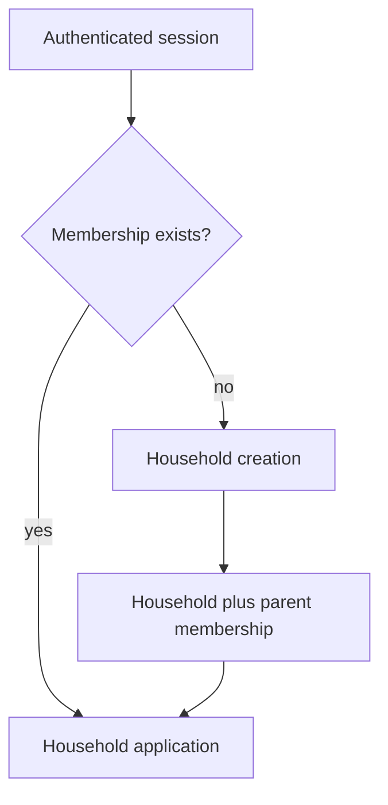

## Context

The foundation supplies username identity but intentionally no application tenant. This change turns the first authenticated user into the first parent of a required household.

## Goals / Non-Goals

**Goals:** session lifecycle, one household bootstrap, timezone confirmation, and server-enforced isolation.

**Non-Goals:** invitations, joining existing households, family account administration, or Todos.

## Decisions

- Persist Household, Membership, and user-to-household lookup items in the dedicated table.
- Treat Cognito `sub` as the membership identity key.
- Create the household and initial parent membership transactionally or make retry idempotent with a request key.
- Resolve household membership in a shared authorization layer before every household route.
- Store an IANA timezone and use date-only transport values, not client timestamps, in later features.

## Risks / Trade-offs

- Self-registration can create isolated unused households; this does not cross tenant boundaries and is acceptable at family scale.
- A failed Cognito sign-up cannot be rolled back from the application; the membership gate prevents it from accessing product content.
