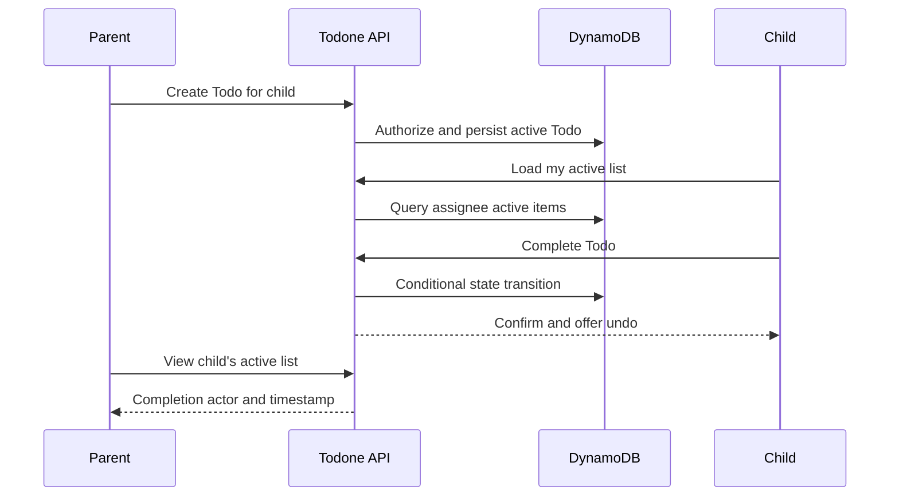

## Context

The first useful vertical slice follows established households and profiles. It needs a small state model, read access patterns for active lists, and server-side completion authority.

## Goals / Non-Goals

**Goals:** create, view, complete, undo, and reopen one-off single-assignee Todos.

**Non-Goals:** edits after creation, archival/history, labels, recurrence, unassigned Todos, and multiple assignees.

## Decisions

- Todo fields include immutable ID, household ID, title, optional due date, assignee snapshot, status, creation metadata, completion metadata, and version.
- Model `ACTIVE` and `COMPLETE`; overdue is a date-derived presentation state, not a stored terminal status.
- Use a household/assignee active-item index for child queries and household membership authorization before access.
- Conditional writes on status and version make completion idempotent and return the current state for double taps or stale clients.
- Use server timestamps and retain display-name/color snapshots needed for stable rendering.

## Risks / Trade-offs

- Parent completion is allowed deliberately; it records the parent as actor rather than impersonating the child.
- No optimistic false success: client UI waits for server confirmation, trading a small delay for correct family visibility.
