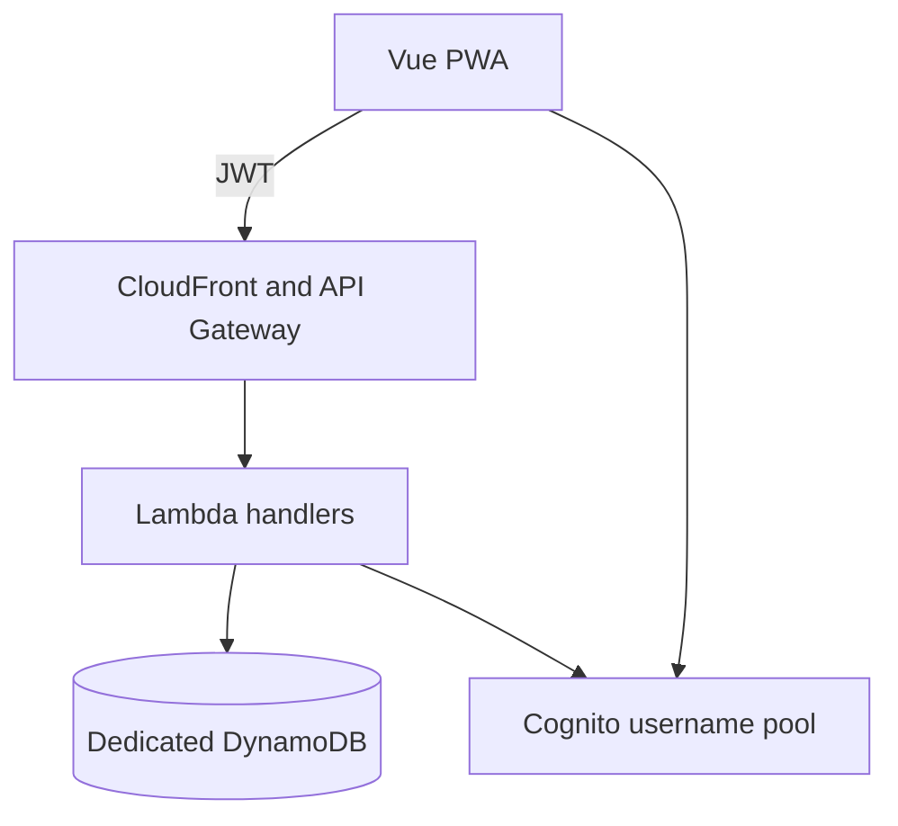

## Context

Todone is a greenfield private family PWA. The local `weather` application demonstrates Vue 3, Vite, TypeScript, Tailwind, PWA, Lambda, and local Express development. `family-paas` provides Terraform modules for S3/CloudFront hosting, API Gateway, Lambda, Cognito, and DynamoDB. Its current shared Cognito pool is unused and email-oriented, so it will be replaced rather than adapted around an incompatible identity model.

## Goals / Non-Goals

**Goals:**
- Establish a deployable, testable, accessible PWA and protected API boundary.
- Use username-only Cognito identities and a dedicated recoverable table.
- Keep operational cost and moving parts low.

**Non-Goals:**
- Household creation, account management, Todo persistence, or recurrence.
- Production automatic deployment on every commit.
- Offline mutation queues or native iOS packaging.

## Decisions

### Runtime architecture

- Use Vue 3, Vite, TypeScript, Tailwind, and the existing PWA pattern.
- Use API Gateway HTTP API JWT authorization for protected routes.
- Replace the empty shared Cognito pool with a case-insensitive username-based pool. Email and phone are optional attributes.
- Use a dedicated on-demand DynamoDB table with `pk` and `sk`, point-in-time recovery, and a typed persistence boundary.
- Use manual reviewed Terraform deployments and retain prior frontend and Lambda artifacts for rollback.

### Reliability and observability

- Runtime writes use request IDs and structured outcome logs. Logs exclude credentials, token values, names, and product content.
- Track API error count and latency, authorization denials, and later recurrence failures. No product analytics is collected.
- Document a point-in-time recovery restore drill. A restore creates a separate table and requires deliberate data verification before cutover.

### Testing strategy

- Unit tests cover local behavior and validation.
- Integration tests cover authenticated API behavior using realistic JWT verification and table access.
- Playwright covers sign-in and protected-route access.
- Accessibility checks cover the shell and sign-in surface at compact and wide viewport sizes.

## Risks / Trade-offs

- Replacing shared Cognito is destructive. Verify it is empty immediately before Terraform apply and coordinate any new platform consumer first.
- DynamoDB requires deliberate query-driven modeling. The product’s bounded family access patterns make this a favorable trade-off over operating a relational database.
- A dedicated table adds no fixed per-table on-demand cost; requests, storage, and PITR are usage-based and negligible at family scale.
