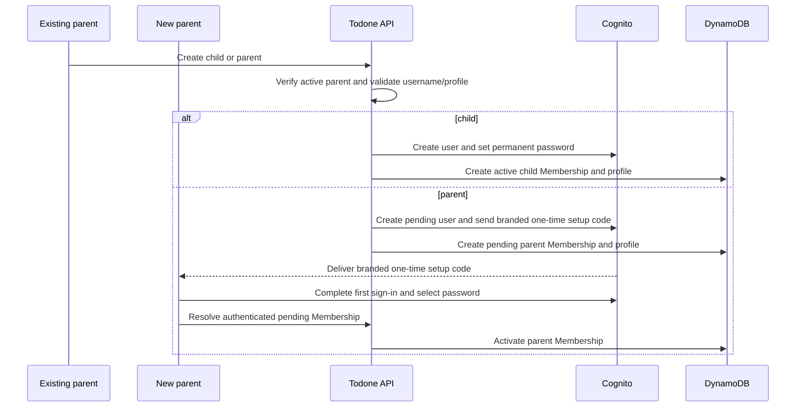

## Context

Households need parent-managed credentials for children and may contain any number of equal parent accounts. Cognito provides globally unique immutable usernames, user provisioning, verified-email parent recovery, and permanent child password reset operations, while Todone owns immutable household roles and mutable, non-unique profile data.

## Goals / Non-Goals

**Goals:** role-appropriate parent/child account creation, parent and child recovery, self-service profile identity, family management, full child removal, and peer-parent safety.

**Non-Goals:** reusable/public household-join invitations, parent removal/demotion, role mutation, shared device switching, and built-in partial-provisioning repair UI. The account-specific additional-parent welcome email is part of activation and is in scope.

## Decisions

- For children, a parent-only API creates the Cognito user with messaging suppressed, sets the supplied permanent password, then creates the Membership and profile.
- The existing pre-signup Lambda treats public `PreSignUp_SignUp` and IAM-authorized `PreSignUp_AdminCreateUser` as independent trust paths. A small pure trigger-source policy requires the Entry Code only for public first-parent signup, permits administrative creation only after the parent-only API and pool-scoped Lambda role authorize it, and rejects unexpected trigger sources. Administrative creation never depends on a previous public signup event. Tests and comments preserve this boundary.
- For parents, `AdminCreateUser` creates a `PENDING_ACTIVATION` account and Cognito emails a generated temporary credential presented to users as a **one-time setup code**. The email links to the activation route without putting username, email, code, or another secret in the URL. The new parent enters username, setup code, and a policy-compliant self-selected password; the client completes Cognito's `NEW_PASSWORD_REQUIRED` challenge. Successful possession and use of the emailed code establishes control of the configured email, after which Membership becomes active and the verified email powers Forgot Password.
- Native Cognito email OTP/passwordless sign-in and custom magic-link authentication are not used. Passwordless OTP changes the account's primary sign-in model and does not naturally end in a permanent user-selected password; a true magic link requires a new application token store, redemption endpoint, replay/expiry controls, and secret-bearing-link review. The Cognito setup-code challenge provides the required proof with the smallest supported mechanism.
- Pending parents appear in family management with status plus `Resend welcome email`, `Change email and resend`, and `Cancel pending account`. Existing parents cannot manually activate them. Resend uses Cognito's supported administrative resend behavior; cancellation removes only a pending identity and its application records.
- Use a Cognito custom-message Lambda with SES developer email delivery for reviewed plain-text and HTML `CustomMessage_AdminCreateUser` copy. Keep email templates in source, include Cognito's username and setup-code placeholders, and never log rendered messages or recipient data. Do not add dedicated IPs, SES Pro/Enterprise plans, or a custom sender unless a later requirement justifies the added fixed cost and KMS/delivery complexity.
- Do not add a provisioning-operation state machine or parent-facing repair UI. Document operator commands to identify and repair/delete an orphan if Cognito and DynamoDB do not both succeed.
- Enforce `parent` and `child` role immutability at the API/persistence boundary. The UI exposes no role mutation control.
- Store the immutable canonical username on Membership as a read-optimized copy of Cognito identity data. Cognito remains the global uniqueness authority. Usernames are normalized to lowercase, contain 3-24 characters from `a-z`, `0-9`, `-`, and `_`, may begin or end with any allowed character, and are immutable. Display name and palette color are non-unique current profile values editable only by that member.
- After the first parent creates a household, require profile setup before family management. Profile setup collects that parent's display name and one canonical palette color, creating the Profile omitted by the bootstrap slice.
- Use the canonical nature-inspired profile palette: `PINE` `#2F6B4F`, `FERN` `#4D7C3F`, `MOSS` `#6B7A3A`, `CLAY` `#B85C3F`, `CEDAR` `#8A5A44`, `MARIGOLD` `#966300`, `LAKE` `#337B8C`, and `DUSK` `#76507A`. Persist stable identifiers rather than arbitrary hex values. Render color with the visible member name and never as the sole identity signal.
- A parent-managed child password reset sets the new permanent Cognito password, invokes pool-scoped `AdminUserGlobalSignOut`, and advances a server-owned credential-validity cutoff on Membership. Household authorization rejects tokens issued at or before that cutoff because Cognito token revocation alone does not make a previously issued self-contained JWT fail API Gateway signature/expiry validation.
- Keep parent recovery email in Cognito and expose it only through that parent's security settings. Replacing it is self-service and staged: retain the old verified address until Cognito verifies the new address, then promote the replacement.
- Full child removal requires confirmation and an extensible cascade. This change deletes Membership/profile, Cognito identity, and currently known child data; each downstream capability must add deletion of its child-associated entities to the same contract and tests. Authorization checks active Membership so stale sessions fail throughout. Release the username only after the complete deployed cascade succeeds.
- Do not retain historical identity snapshots for a removed child because downstream capabilities must delete that child's associated history. Existing records for active members resolve current display name and color from the profile.
- Follow the shared authorization matrix, data/access-pattern, interaction-state, and operations documents established by the foundation.

### Routing and browser history

- Use one client-side router as the source of truth for page-level navigation. Component-local state may control temporary disclosure and dialogs, but it SHALL NOT represent a distinct page that users reasonably expect to bookmark, reload, or revisit with browser Back/Forward.
- Complete this routing slice before shared visual-foundation implementation or additional family-account UI. Routing first isolates navigation, authorization guards, and secret-clearing behavior from the later visual refactor.
- Use `vue-router` as the conventional Vue 3 routing dependency and source of truth. Use the canonical public routes `/sign-in`, `/register`, `/verify-email`, `/forgot-password`, `/reset-password`, and `/activate-parent`. Use the canonical authenticated routes `/todos`, `/household/setup`, `/profile/setup`, `/family`, `/profile`, `/security`, `/family/children/new`, and `/family/parents/new`. `/` resolves the current authenticated/onboarding state and replaces itself with the appropriate canonical route rather than adding a redundant history entry.
- Until the first Todo vertical slice ships, `/todos` is a nonfunctional work-in-progress page. An active child with a Profile lands there. It contains no fabricated Todo records, completion or creation controls, disabled promises of future actions, or Todo API calls. Parents continue to land on the nearest currently useful authorized surface; the later Todo slice may make `/todos` their home when real household/member lists exist.
- Ordinary link/button navigation pushes a history entry. Automatic normalization and authorization/onboarding redirects replace the current entry. Back and Forward restore the corresponding safe surface without replaying a mutation, resubmitting a form, or resurrecting secret input.
- A reload or direct visit resolves the current Cognito session, Membership, role, activation state, and Profile before rendering protected content. Signed-out users are sent to `/sign-in`; missing household/profile prerequisites are sent to their required setup route; unauthorized, stale, or unknown family routes fall back to the nearest safe canonical route without revealing whether another resource exists.
- Route paths, query strings, fragments, and persisted history state contain no password, Entry Code, verification code, one-time setup code, token, recovery email, submitted email, or username. Verification, reset, and activation routes collect required identity and secret values again in current in-memory form state when necessary.
- Route transitions set a meaningful document title and move focus to the destination heading or an intentional error summary. A destructive confirmation may remain a modal over its owning route; opening, canceling, confirming, or traversing history SHALL never imply that a write occurred before the server confirms it.

## Visual and UX Direction

- Apply `visual-design-foundation` before final family-management styling. Explore the compact family directory, first-parent profile setup, child creation, pending-parent state, and self-profile editing with realistic long names, usernames, role/state metadata, and authorized actions.
- Create the pre-implementation family-account reference as a quick self-contained HTML page under `docs/ux/references/`, present it to the product owner for human review, and retain the accepted page as a decision reference. It is not a production route or a post-implementation validation surrogate.
- Keep member identity warm but restrained: name is primary, canonical profile color is a compact supporting cue in shared directories, and username/role/state form a consistent metadata line. On that member's own home and Todo surfaces, an accessible derived tonal family may influence the header and full-bleed canvas without applying the raw base hex or changing semantic action/status colors. Do not introduce avatars, animals, illustrated identities, or profile-color-filled directory cards.
- Use progressive disclosure for administrative complexity. On compact layouts, the directory is a continuous full-width member list rather than stacked cards; row navigation remains link-like, while password reset, resend/change/cancel, and destructive removal remain clearly labelled buttons because they initiate actions. Recovery email and focused forms open on their own route or confirmation surface instead of expanding every row into a settings panel.
- Treat every focused page-level form in the canonical route map as a real navigation destination. Reference states SHALL show route transitions and the expected Back destination as well as the visual composition.
- Preserve a prominent route from the parent shell to Todo creation once that capability exists. Family management remains reachable but must not become the default parent home solely because it contains more controls.
- Review pending, active, provisioning, partial-failure, session-cutoff, and destructive-confirmation compositions before implementation. Deep forest, profile-derived context, and warm form surfaces should organize the density without using status color as the only signal.
- Perform visual review on actual UI and the branded welcome email. Verify long-content wrapping, keyboard/focus order, 320-pixel reflow, 200-percent zoom, reduced motion, and every palette/text combination before completing the feature UI.
- For post-implementation product-owner review, provide concise UX journeys that name the starting role/state, canonical route, actions, and expected visible/focus/navigation result. The product owner reviews the real app through those journeys; no second post-implementation mockup is required.

## Risks / Trade-offs

- The runtime needs privileged Cognito operations; IAM must scope actions to the Todone user pool and all authorization occurs before calling Cognito.
- `AdminCreateUser` is IAM-authorized and is not callable through the public browser app client. A compromise of the Lambda role is therefore the relevant administrative-creation threat; least-privilege pool scoping and parent authorization are mandatory.
- Permanent passwords make child onboarding simple but require strong transport security and strict no-log handling.
- SES developer delivery is usage-priced and Cognito Lite/Essentials includes an ongoing free MAU tier, so expected family usage is negligible; infrastructure review must still reject fixed-cost SES plans, dedicated IPs, or an unintended Cognito tier upgrade.
- Full deletion crosses Cognito and DynamoDB without a shared transaction. If it partially fails, fail closed through active-membership checks and use the operator runbook before releasing the username.
