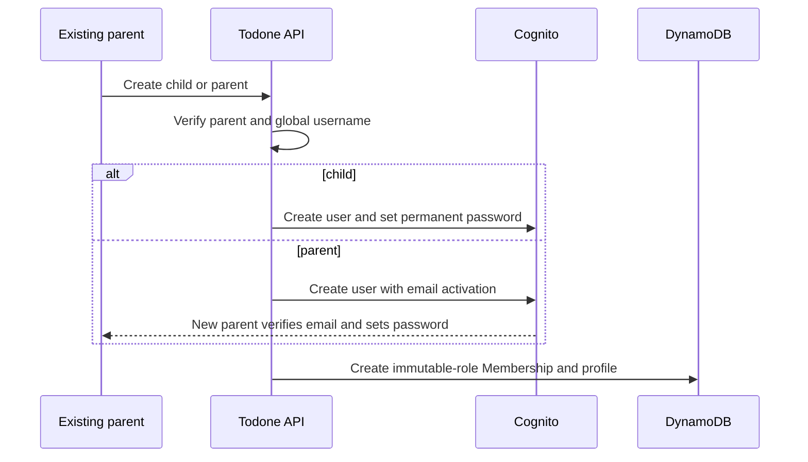

## Context

Households need parent-managed credentials for children and may contain any number of equal parent accounts. Cognito provides globally unique immutable usernames, user provisioning, verified-email parent recovery, and permanent child password reset operations, while Todone owns immutable household roles and mutable, non-unique profile data.

## Goals / Non-Goals

**Goals:** role-appropriate parent/child account creation, parent and child recovery, self-service profile identity, family management, full child removal, and peer-parent safety.

**Non-Goals:** household invitations, parent removal/demotion, role mutation, shared device switching, and built-in partial-provisioning repair UI.

## Decisions

- For children, a parent-only API creates the Cognito user with messaging suppressed, sets the supplied permanent password, then creates the Membership and profile.
- For parents, the API creates an account with required email activation; the new parent verifies their email and selects their own password before the parent Membership becomes active. That verified email powers Cognito Forgot Password.
- Do not add a provisioning-operation state machine or parent-facing repair UI. Document operator commands to identify and repair/delete an orphan if Cognito and DynamoDB do not both succeed.
- Enforce `parent` and `child` role immutability at the API/persistence boundary. The UI exposes no role mutation control.
- Store username separately from profile display name. Username is globally unique and immutable; display name and palette color are non-unique current profile values editable only by that member.
- Keep parent recovery email in Cognito and expose it only through that parent's security settings. Replacing it is self-service and staged: retain the old verified address until Cognito verifies the new address, then promote the replacement.
- Full child removal requires confirmation and an extensible cascade. This change deletes Membership/profile, Cognito identity, and currently known child data; each downstream capability must add deletion of its child-associated entities to the same contract and tests. Authorization checks active Membership so stale sessions fail throughout. Release the username only after the complete deployed cascade succeeds.
- Do not retain historical identity snapshots for a removed child because downstream capabilities must delete that child's associated history. Existing records for active members resolve current display name and color from the profile.
- Follow the shared authorization matrix, data/access-pattern, interaction-state, and operations documents established by the foundation.

## Risks / Trade-offs

- The runtime needs privileged Cognito operations; IAM must scope actions to the Todone user pool and all authorization occurs before calling Cognito.
- Permanent passwords make child onboarding simple but require strong transport security and strict no-log handling.
- Full deletion crosses Cognito and DynamoDB without a shared transaction. If it partially fails, fail closed through active-membership checks and use the operator runbook before releasing the username.
