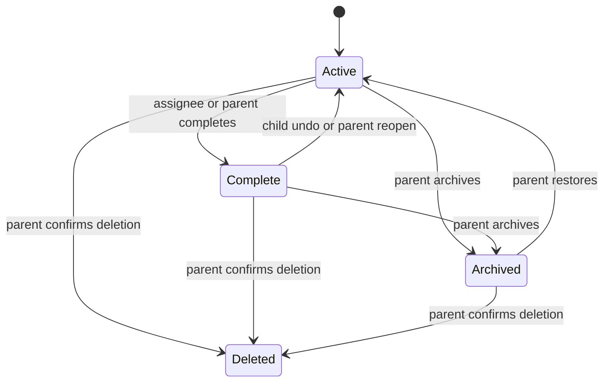

## Context

The first Todo slice contains active and complete work only. This change adds correction, archive, history, and permanent deletion while retaining a clear distinction between reversible archival and irreversible removal.

## Goals / Non-Goals

**Goals:** parent lifecycle control, durable role-scoped history, and safe concurrent updates.

**Non-Goals:** recurrence states, child editing, labels, bulk operations, and retention expiry.

## Decisions

- Preserve one Todo record and lifecycle audit fields rather than copying history into a separate mutable document.
- Maintain active and historical query projections keyed by assignee and household.
- Store versioned conditional writes for edit, archive, restore, delete, completion, undo, and reopen.
- Snapshot assignee display identity at assignment and preserve it after account removal or profile rename.
- Children receive history queries only for their own assignee ID and read-only response shapes.

## Risks / Trade-offs

- Permanent deletion conflicts with “keep history forever”; archive is surfaced as the default, and deletion needs a confirmation dialog.
- Concurrent edits require explicit refresh messaging rather than last-write-wins data loss.

## Migration Plan

- Extend existing Todo records with a default `ACTIVE` or `COMPLETE` lifecycle status and version.
- Deploy read compatibility first, then lifecycle write routes and UI.
- Roll back by disabling new routes/UI; no automatic restoration of explicitly deleted records is possible.
