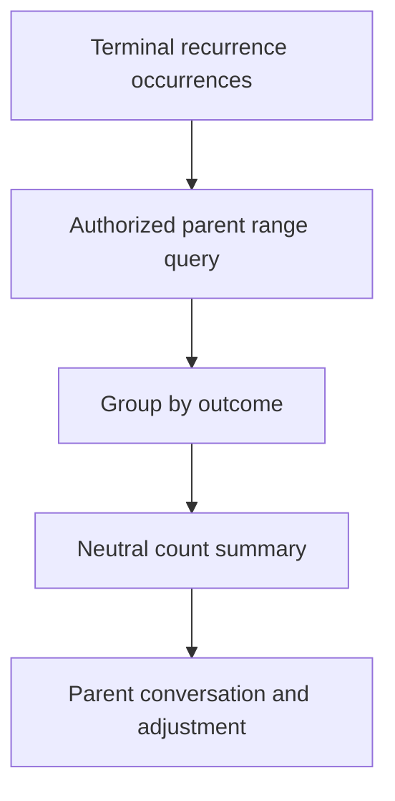

## Context

Routine occurrences retain terminal historical states after daily, weekly, and monthly rounds. Parents want a bounded, non-gamified way to inspect these records for one child and one routine at a time.

## Goals / Non-Goals

**Goals:** correct parent-only outcome aggregation and neutral accessible presentation.

**Non-Goals:** sibling comparison, scores, charts as the sole representation, automated recommendations, notifications, or child trend access.

## Decisions

- Query terminal occurrence records using household, template, assignee, and local-date index fields; aggregate in the API at family-scale rather than introducing analytics infrastructure.
- Require parent membership before query and constrain child/template IDs to the caller's household.
- Present textual counts first; any visual chart is supplementary and has a text equivalent.
- Define supported bounded date ranges to avoid unbounded scans. Stopped templates remain queryable.

## Risks / Trade-offs

- Historical records may grow over years; bounded ranges and family scale keep on-demand DynamoDB aggregation practical. If data becomes large, add precomputed rollups in a later change.
- Neutral wording cannot prevent interpersonal pressure; excluding rankings and scores avoids encoding it into product behavior.
